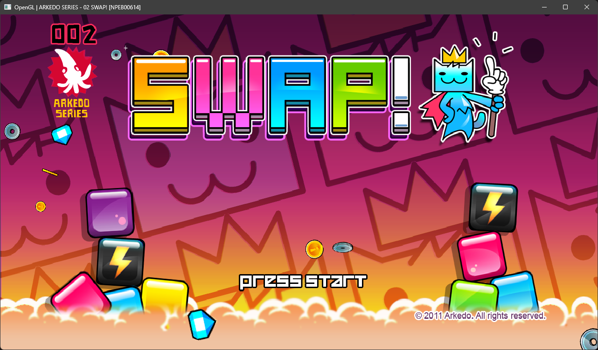
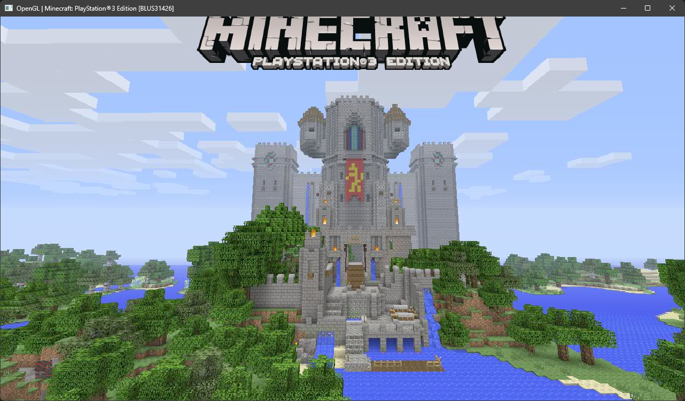

# PS3Sharp

PS3Sharp is a simple PlayStation 3 emulator written in C#.

This project is intended for educational purposes and personal interest in emulation development, and is not intended to be an end-user product.

# Build
Clone the repository. Then, you can build using either:
- Visual Studio: Open PS3Sharp.slnx and build the solution
- .NET CLI: Run ```dotnet build PS3Sharp.slnx```

# Usage
TODO

# Acknowledgements

This project explicitly builds upon information and code from:
- [RPCS3](https://github.com/RPCS3/rpcs3)
- [ChonkyStation3](https://github.com/liuk7071/ChonkyStation3/)

It also uses documentation and resources from:
- [PS3DevWiki](https://www.psdevwiki.com/ps3/)
- [PSL1GHT](https://github.com/ps3dev/PSL1GHT)

# Showcase




